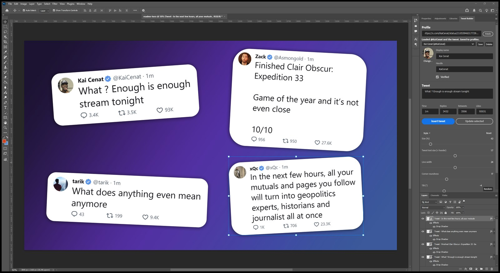
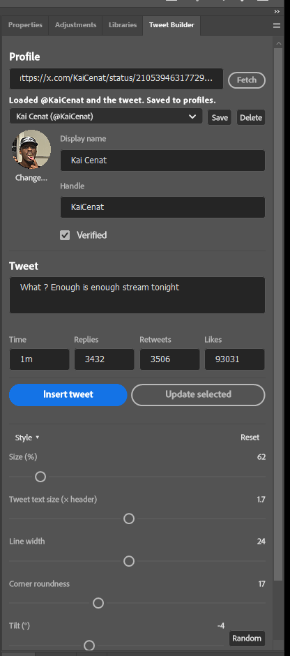
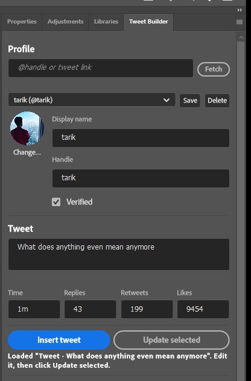

# Tweet Builder for Photoshop

A Photoshop panel that builds tweet cards for YouTube thumbnails. You don't need to screenshot
a web generator, upscale a blurry JPG and mask it by hand: paste a tweet link (or type your
own) and click **Insert**. The card is built from real text and vector layers, so it stays
sharp at 4K, and you can come back and edit it later.

These are real public tweets from Kai Cenat, Asmongold, tarik and xQc, pulled in with the
tweet-link fetch.

## Features

- **Fetch from X:** paste a tweet link to get the real display name, avatar, verified badge,
  text and reply/retweet/like counts. An `@handle` gets the avatar on its own.
- **Saved profiles:** each profile is fetched once, then picked from a dropdown.
- **Thumbnail-ready style:** a rounded "pill" card, enlarged tweet text, drop shadow and an
  optional tilt, all adjustable.
- **Native and sharp:** the card is a smart object made of live text, shapes and vector icons,
  so it has no upscaling blur.
- **Edit later:** select a card and its settings load back into the panel. Change the text,
  counts or profile, then click **Update selected**. Its position, tilt, scale and effects are
  kept.
- **One undo step** per insert or update.

## Install

1. Download **[Tweet-Builder.ccx](https://github.com/Nicolaysj/photoshop-tweet-builder/releases/latest/download/Tweet-Builder.ccx)**
   from the [latest release](https://github.com/Nicolaysj/photoshop-tweet-builder/releases/latest).
2. Double-click the file. Creative Cloud opens and installs it. It will warn that the plugin
   isn't verified by Adobe, because it's shared here rather than through the Adobe
   marketplace. Click **Install** to continue.
3. In Photoshop, open **Plugins → Tweet Builder**. If Photoshop was already open and the menu
   item doesn't appear, restart Photoshop.

To update, download the newer `.ccx` and double-click it again. To remove the plugin, use
**Manage plugins** in the Creative Cloud desktop app.

Requirements: Photoshop 2024 (v25) or newer. Tested on Photoshop 2026 on Windows. Cards use
the Segoe UI font, which comes with Windows; on macOS, Photoshop substitutes another font
unless Segoe UI is installed.

### Install from source

To run the latest code or work on the plugin itself:

1. Download this repo: **Code → Download ZIP**, then unzip it (or `git clone` it).
2. Install **UXP Developer Tool** from the Creative Cloud app (search for "UXP").
3. In Photoshop, turn on **Preferences → Plugins → Enable Developer Mode**, then restart
   Photoshop.
4. In UXP Developer Tool, click **Add Plugin**, choose this folder's `manifest.json`, then
   click **Load** under ••• (Actions).

A copy loaded this way keeps its saved profiles separately from an installed `.ccx` copy.

## How to use it

### 1. Get a profile

Paste a **tweet link** into the top field and click **Fetch**. The name, handle, avatar,
verified badge, tweet text and counts all fill in, and the profile is saved for next time.

You can also enter just an **@handle**. That always gets the avatar, but X only sometimes
returns the display name for a handle, so check the name and click **Save**.

Saved profiles live in the **Saved profiles** dropdown. **Change…** sets the avatar from an
image file instead.

### 2. Write the tweet

Type or edit the text and set the time label (`1m`, `48s`, `2h`). Counts accept plain numbers
(`2400` shows as `2.4K`) or text as-is. Leave a count empty to show just the icon.

### 3. Insert

Click **Insert tweet**. The card lands centred in your open document, above the selected
layer, with a drop shadow. Move, scale and rotate it like any smart object. Double-click it to
get at the individual layers inside.

Open **Style ▸** to adjust:

- size
- tweet text size (relative to the name line)
- line width
- corner roundness
- tilt (with a **Random** button)
- drop shadow

**Reset** restores the defaults.

 

### 4. Edit a card later

Select a card in the Layers panel and its settings load into the panel. Change anything,
then click **Update selected**. The card is rebuilt in place, and its position, tilt, scale,
shadow, masks and layer order stay exactly as you left them. If the new text changes the
card's size, it grows or shrinks around its centre.

Each card stores its settings in the layer's metadata, so this still works after saving and
reopening the PSD.

 

## Good to know

- Profile data comes from the public [FxTwitter](https://github.com/FixTweet/FxTwitter) API
  and [unavatar.io](https://unavatar.io). Neither is affiliated with X, so lookups can
  occasionally fail. You can always type the details in yourself.
- Only the light theme is supported for now, and emoji in tweet text aren't rendered yet.
- Please don't use it to pass off made-up tweets as real ones. It's meant for thumbnails,
  memes and mockups.

## Development

- `src/builder.js` lays out the card with Photoshop's batchPlay/DOM APIs, `src/profiles.js`
  handles lookups and saved profiles, and `src/main.js` wires up the panel.
- `src/dev.js` is a test harness that only runs when a `dev/enabled` file exists (git-ignored).
  It picks up `dev-job.json` files from the plugin's data folder, so builds can be scripted
  and checked without clicking through the UI.

## Support

If Tweet Builder saves you some time, you can buy me a coffee on
[Ko-fi](https://ko-fi.com/nixolay). Thank you!
